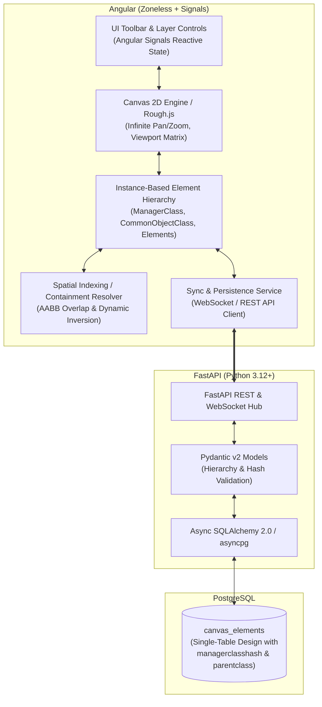
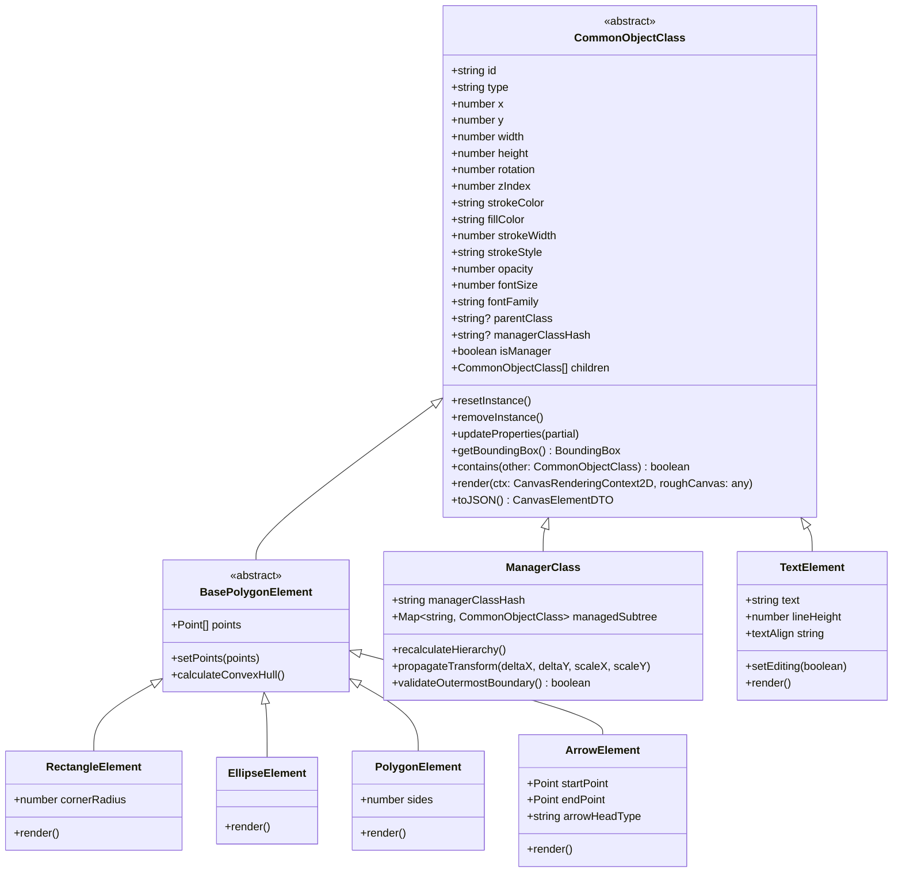

# Whiteboard System Architecture & Implementation Specification

An Excalidraw-inspired whiteboard application built with **Angular (Zoneless + Signals)**, **HTML5 Canvas (Rough.js)**, **FastAPI (Python 3.12+)**, and **PostgreSQL**.

---

## 1. System Overview & Architecture



---

## 2. Object-Oriented Element Model

Every shape, polygon, and text on the whiteboard is an instance of an object-oriented class hierarchy.



### 2.1 Hierarchy Breakdown

1. **`CommonObjectClass` (Root Base Class)**:
   - Shared attributes: coordinates (`x`, `y`), dimensions (`width`, `height`), `rotation`, `zIndex`, `strokeColor`, `fillColor`, `strokeWidth`, `strokeStyle`, `opacity`, `fontSize`, `fontFamily`.
   - Structural pointers: `parentClass` (nullable string), `managerClassHash` (nullable string), `isManager` (boolean), `children` array.
   - Lifecycle operations:
     - `resetInstance()`: Resets styling or points to initial creation defaults.
     - `removeInstance()`: Detaches element from parent and manager, removes children, and cleans up references.
     - `updateProperties(patch)`: Modifies styles and coordinates reactively.
     - `contains(other)`: Checks bounding-box containment.
     - `render(ctx, roughCanvas)`: Renders element using rough.js hand-drawn style or clean canvas paths.
     - `toJSON()`: Serializes instance for single-table database persistence.

2. **`BasePolygonElement`**:
   - Abstract polygon class holding `points: Point[]` with vertex editing, translation, and convex hull algorithms.

3. **Specialized Shape Classes**:
   - `RectangleElement`: Standard rectangles, rounded cards, boxes.
   - `EllipseElement`: Circles and ellipses.
   - `PolygonElement`: Diamonds, triangles, n-gons, stars.
   - `ArrowElement` / `LineElement`: Linear and curved arrows with bindings to other shapes.
   - `TextElement`: Multiline text, inline HTML canvas overlay editor, dynamic font metric resizing.

---

## 3. Dynamic Containment & ManagerClass Rules

### 3.1 Parent-Child Containment
- When an element (Box B) is created or resized inside Box A such that Box A bounds Box B:
  - Box B's `parentClass` is assigned Box A's `id`.
  - Box B is added to Box A's `children`.
  - Translating or scaling Box A propagates relative translation to Box B.

### 3.2 Dynamic Inversion (Child Becomes Parent)
- When Child Box B is scaled or resized such that its bounding box now completely encloses Box A:
  - **Hierarchy Inversion**: Box B becomes the parent; Box A becomes the child.
  - `Box A.parentClass = Box B.id`
  - `Box B.parentClass = null` (or Box A's prior parent).

### 3.3 Outermost Bounding Polygon as `ManagerClass`
- Only the **outermost bounding polygon** in any containment tree is designated as the `ManagerClass`.
- The `ManagerClass` generates a deterministic hash:
  $$\text{managerclasshash} = \text{hash}(\text{rootManagerId} + \text{boardId})$$
- All nested child/grandchild elements carry this `managerclasshash` in their state and database record.
- Independent root elements without children have `parentclass = NULL` and `managerclasshash = NULL`.
- If the current manager shrinks and is contained by another polygon, the manager role transfers to the new outermost polygon, recomputing the hash for all elements in the subtree.

---

## 4. Single-Table Database Schema (PostgreSQL)

Strict single-table design with `managerclasshash` and `parentclass` (nullable).

```sql
CREATE TABLE canvas_elements (
    id VARCHAR(64) PRIMARY KEY,
    board_id VARCHAR(64) NOT NULL,
    type VARCHAR(32) NOT NULL,                  -- 'rectangle', 'text', 'polygon', 'ellipse', 'arrow', etc.
    
    -- Hierarchy & Manager pointers (Nullable)
    parentclass VARCHAR(64) DEFAULT NULL,       -- Foreign key / pointer to immediate parent
    managerclasshash VARCHAR(128) DEFAULT NULL, -- Hash of outermost bounding manager polygon
    
    -- Spatial and Transform Coordinates
    x DOUBLE PRECISION NOT NULL DEFAULT 0.0,
    y DOUBLE PRECISION NOT NULL DEFAULT 0.0,
    width DOUBLE PRECISION NOT NULL DEFAULT 0.0,
    height DOUBLE PRECISION NOT NULL DEFAULT 0.0,
    rotation DOUBLE PRECISION NOT NULL DEFAULT 0.0,
    z_index INTEGER NOT NULL DEFAULT 0,
    
    -- Flexible Instance Payload (points, text, stroke, fill, rough settings, metadata)
    properties JSONB NOT NULL DEFAULT '{}'::jsonb,
    
    -- Metadata and Sync Concurrency
    version INTEGER NOT NULL DEFAULT 1,
    is_deleted BOOLEAN NOT NULL DEFAULT FALSE,
    created_at TIMESTAMPTZ NOT NULL DEFAULT NOW(),
    updated_at TIMESTAMPTZ NOT NULL DEFAULT NOW()
);

-- Indices for rapid queries
CREATE INDEX idx_canvas_elements_board_id ON canvas_elements(board_id) WHERE NOT is_deleted;
CREATE INDEX idx_canvas_elements_manager_hash ON canvas_elements(managerclasshash) WHERE managerclasshash IS NOT NULL;
CREATE INDEX idx_canvas_elements_parent ON canvas_elements(parentclass) WHERE parentclass IS NOT NULL;
CREATE INDEX idx_canvas_elements_spatial ON canvas_elements(board_id, x, y, width, height);
```

---

## 5. Technology Stack

- **Frontend**:
  - Angular 22 with `provideExperimentalZonelessChangeDetection()` (no Zone.js overhead).
  - Angular Signals (`signal()`, `computed()`, `effect()`) for reactive rendering and state management.
  - HTML5 Canvas (Dual-layer: Rough.js hand-drawn style canvas + interaction overlay canvas for handles/marquee).
- **Backend**:
  - FastAPI (Python 3.12+).
  - SQLAlchemy 2.0 (Async) + asyncpg.
  - Pydantic v2 schemas.
  - WebSocket hub for live multi-user synchronization.
- **Database**:
  - PostgreSQL 16+.

---

## 6. Directory Structure

```plaintext
whiteboard/
├── ARCHITECTURE.md
├── backend/
│   ├── app/
│   │   ├── api/
│   │   │   ├── v1/
│   │   │   │   ├── endpoints/
│   │   │   │   │   ├── boards.py
│   │   │   │   │   ├── elements.py
│   │   │   │   │   └── ws.py
│   │   │   │   └── router.py
│   │   ├── core/
│   │   │   ├── config.py
│   │   │   └── database.py
│   │   ├── models/
│   │   │   └── element.py
│   │   ├── schemas/
│   │   │   └── element.py
│   │   ├── services/
│   │   │   ├── element_service.py
│   │   │   └── hierarchy_service.py
│   │   └── main.py
│   ├── alembic/
│   ├── requirements.txt
│   └── run.py
│
└── frontend/
    ├── src/
    │   ├── app/
    │   │   ├── core/
    │   │   │   ├── engine/
    │   │   │   │   ├── canvas-renderer.ts
    │   │   │   │   ├── viewport.ts
    │   │   │   │   └── spatial-index.ts
    │   │   │   ├── models/
    │   │   │   │   ├── common-object.ts
    │   │   │   │   ├── manager-class.ts
    │   │   │   │   ├── base-polygon.ts
    │   │   │   │   ├── rectangle.ts
    │   │   │   │   ├── text.ts
    │   │   │   │   ├── ellipse.ts
    │   │   │   │   ├── arrow.ts
    │   │   │   │   └── polygon.ts
    │   │   │   └── services/
    │   │   │       ├── canvas-state.service.ts
    │   │   │       ├── hierarchy-manager.service.ts
    │   │   │       ├── history.service.ts
    │   │   │       └── api-sync.service.ts
    │   │   ├── components/
    │   │   │   ├── whiteboard/
    │   │   │   ├── toolbar/
    │   │   │   ├── properties-panel/
    │   │   │   └── inline-text-editor/
    │   │   └── app.config.ts
    │   └── main.ts
    ├── package.json
    └── angular.json
```
